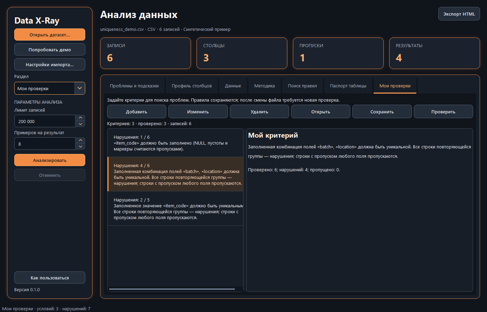

# Data X-Ray 0.1.0

Локальное настольное приложение для анализа одного CSV, XLSX или
Parquet. Объясняет проблемы с примерами записей, находит правила и сравнивает
паспорта таблиц. Данные обрабатываются на компьютере; исходные файлы не меняются.

Версия **0.1.0** распространяется в виде исходников и требует установки Python.
Проверенная платформа — **Windows x64, Python 3.12**. Исходники требуют Python
3.10+, но другие версии Python и ОС пока не прошли такую же приемку.



## Установка и запуск

Скачайте исходники, распакуйте их и откройте PowerShell в папке проекта.

```powershell
py -3.12 -m venv .venv
.\.venv\Scripts\python.exe -m pip install -r requirements-lock.txt
.\run.cmd
```

Если Python 3.12 вызывается командой `python`, используйте ее вместо `py -3.12`.
Для установки минимальных зависимостей приложения есть `requirements.txt`,
для разработки — `requirements-dev.txt`. Lock-файл содержит точные версии
проверенного окружения. Альтернативный помощник установки — `setup.ps1`.

На уже настроенном компьютере достаточно дважды щелкнуть **run.cmd**. Консоль
запуска быстро закроется, останется окно приложения. `run.ps1` — альтернативный
способ запуска. Для запуска совсем без появления консоли создайте ярлык на
`.venv\Scripts\pythonw.exe -m data_xray.gui_entry` с рабочей папкой проекта.
Ошибки запуска записываются в `%LOCALAPPDATA%\DataXRay\logs\startup.log`, а при
недоступности этой папки — в `%TEMP%\DataXRay\logs\startup.log`.

## Что умеет приложение

| Раздел | Возможности |
| --- | --- |
| Проблемы и подсказки | Пропуски, полные дубликаты, кандидаты в ключи, ошибки типов, выбросы, строковые и календарные аномалии; приоритет и примеры |
| Профиль столбцов | Физический/предполагаемый тип, NULL/пустоты/маркеры, число различных значений, уникальность, статистика и частые значения |
| Данные | До 1 000 исходных записей или записи выбранного нарушения |
| Методика | Параметры, правила чтения и ограничения завершенного анализа |
| Поиск правил | Семь семейств автоматических гипотез, принятие/отклонение, свои условия, сохранение набора и повторная проверка |
| Паспорт таблицы | Структура и профиль, отпечатки, сохранение JSON и сравнение текущего паспорта с эталоном |
| Мои проверки | Собственные условия, проверка заполненности/уникальности/диапазона/формата, сохранение набора; нарушения попадают в список проблем |

Название рабочего экрана — **«Анализ данных»**. Список **«Раздел»** слева
открывает любую вкладку, в том числе в компактном окне. Под кнопкой помощи
постоянно показана версия. **«Как пользоваться»** запускает обучение из
**18 шагов**: карточки находятся внутри окна рядом с выделенными элементами.
Есть «Назад», «Далее», «Готово», закрытие по Escape и настройка автопредложения.

Явные числовые условия сравнивают значения без промежуточного округления,
включая большие целые. Точность уже округленных чисел в исходном файле
восстановить нельзя. Целые границы сохраняются точно; при вводе слишком
точной дробной границы приложение предложит сократить дробную часть.
При ошибке сохранения JSON правил, паспорта или решений предыдущий файл
остается доступным.

## Первый анализ

1. Нажмите **«Попробовать демо»** или **«Открыть датасет…»**. Для CSV выберите
   разделитель/кодировку, для XLSX — лист. Для Parquet дополнительных полей нет.
2. Задайте лимит записей и число примеров, нажмите **«Анализировать»**. Работа
   выполняется в фоне; доступны этапы загрузки и отмена. При ошибке/отмене
   предыдущий успешный результат сохраняется.
3. Выберите проблему. Справа будут причина, следующий шаг и примеры.
   **«Показать затронутые записи»** открывает исходные позиции в разделе данных.
4. **«Экспорт HTML»** сохраняет автономный отчет по всем результатам независимо
   от текущих фильтров; в нем есть исходные примеры.

Номера записей начинаются с 1 после заголовка. Для CSV с переносами внутри поля
или пустыми физическими строками это не номера строк текстового файла.
«Гипотеза» требует решения аналитика: выброс или кандидат в ключ может быть
корректен. Отсутствие проблем не доказывает отсутствие бизнес-ошибок.

## Статусы и сохраненные обзоры

Назначьте выбранной проблеме статус **«Не разобрано»**, **«Подтверждено»**,
**«Не проблема»** или **«Исправлено»** и нажмите «Применить». Добавьте заметку
через **«Комментарий…»**. Статус «Исправлено» не изменяет значения в файле.

**«Удалить»** скрывает проблему из активного списка. В фильтре **«Удаленные»**
можно ее восстановить. **«Сохранить обзор…»** записывает весь анализ, статусы и
заметки, включая удаленные элементы, в JSON. **«Открыть обзор…»** показывает
снимок отдельно. Восстановить только отметки можно, если снимок точно совпадает
с текущим анализом и его источником; чужие результаты и номера строк не
переносятся. HTML включает удаленные элементы с пометкой.

## Поиск правил и собственные условия

После анализа нажмите **«Найти правила»**. Предлагаются заполненность,
допустимые категории, числовой диапазон, формат строки, зависимость столбцов,
условная обязательность и сравнение чисел/дат. **«Демо правил»** создает
отдельный пример с 150 записями, 9 столбцами и 35 кандидатами.

Прочитайте применимость, нарушения и долю выполнения; выберите **«Принять»**
или **«Отклонить»**. **«Сохранить набор»** экспортирует только принятые правила.
После анализа следующего файла **«Проверить набор»** выполняет их без
переобучения. **«Правило…»** позволяет создать свое условие, изменить
поддерживаемое правило или удалить его. Доля выполнения — наблюдаемая частота,
а не вероятность истинности правила.

В **«Моих проверках» → «Добавить»** доступен тот же конструктор:

| Условие | Как задается |
| --- | --- |
| Число в моем диапазоне | Нижняя/верхняя граница необязательны; отдельные флажки включают равенство |
| Уникальное значение | Один столбец; все участники повторяющейся группы являются нарушениями |
| Уникальность по нескольким полям | Отметьте 2–32 поля; проверяется уникальность их комбинации, а не каждого поля отдельно |
| Обязательное значение | NULL, пустота и стандартные текстовые маркеры являются нарушениями |
| Допустимые категории | Точные значения через `;`, без потери пробелов и ведущих нулей |
| Дата | Готовый формат или свой ограниченный `%Y`, `%m`, `%d`, `%H`, `%M`, `%S`; проверяются ширина и календарь |
| Формат строки | Электронная почта или цифры |
| Регулярное выражение | Совпадение всей строки, свои шаблоны до 512 символов и готовые примеры кода/телефона/индекса |

Предметные пресеты «Возраст», «Цена» и создание UUID убраны. Старые сохраненные
диапазоны и UUID-условия продолжают читаться. Используется Rust regex в Polars:
группы, классы и повторения доступны; обратные ссылки и lookaround не
поддерживаются. Ошибки условия показываются до сохранения.

Вне обязательности пропуски пропускаются. Для обязательного формата нужны два
условия: заполненность и формат. Уникальность пропускает строку, если не
заполнено хотя бы одно поле комбинации; сравнение не обрезает пробелы и не
меняет регистр. Заполненные неверные числа/даты — нарушения. Отсутствующий
столбец или ноль применимых строк — **«Не применимо»**, а не успех.

После изменения списка критериев запустите **«Проверить»**. При следующем
**«Анализировать»** критерии из памяти выполняются автоматически. Старые оценки
очищаются при смене файла/параметров; спецификации остаются. Наборы сохраняются
в JSON v2, чтение v1 поддержано. Автоматические межстолбцовые зависимости пока
не редактируются одностолбцовым конструктором.

**Пример уникальности:** откройте `examples/uniqueness_demo.csv`, выполните
анализ, затем откройте `examples/uniqueness_criteria.json` в «Моих проверках».
Повтор `item_code` затрагивает записи **1, 3**; повтор комбинации `location`
и `batch` — **1, 2, 4, 5**; обязательность кода — запись **6**.

## Паспорт таблицы

Паспорт создается после анализа. **«Сохранить JSON»** записывает профиль;
**«Открыть эталон» → «Сравнить»** показывает добавленные/удаленные столбцы,
смену типов, дельты пропусков/уникальности, диапазонов и частых значений.
Эталон сохраняется при смене датасета. Вторая сырая таблица не нужна.

Отпечаток профиля **не является хэшем всех значений** и не доказывает равенство
таблиц. Частотное сравнение ограничено top-5: неизвестная частота не равна нулю.
Отличия лимитов и параметров помечаются; выводы относятся к прочитанным данным.

## Командная строка

```powershell
# Демо и полный отчет без интерфейса.
.\run.cmd --demo --html report.html --json report.json

# Поиск кандидатов и проверка принятого набора.
.\run.cmd examples\rule_miner_demo.csv --mine-rules --html rules.html
.\run.cmd examples\rule_miner_changed.csv --rule-set accepted.json --html checked.html

# Мои проверки и паспорт.
.\run.cmd examples\uniqueness_demo.csv --criteria examples\uniqueness_criteria.json --save-passport baseline.json --html report.html
.\run.cmd another.csv --compare-passport baseline.json --html comparison.html
```

Новые параметры требуют `--html`; `--mine-rules` и `--rule-set` взаимоисключающие.
Код выхода: 0 — анализ выполнен, 1 — ошибка файла/анализа/набора, 2 — неверные
аргументы. Наличие нарушений само по себе не меняет код 0. Запуск отчетов через
`run.cmd` синхронный. CSV поддерживает `--separator` и `--encoding`, XLSX — `--sheet`.

## Ограничения и конфиденциальность

- Файл до 256 МБ, до 500 столбцов и 5 млн анализируемых ячеек. По умолчанию
  первые 200 000 записей; это начало файла, а не случайная выборка. Таблица
  и представления значений находятся в RAM.
- CSV читается как текст с сохранением ведущих нулей. XLSX: один лист,
  формулы читаются как текст и не вычисляются. Parquet сохраняет скалярные
  типы; вложенные/бинарные столбцы отклоняются. `.xls`/`.xlsm` не поддержаны.
- Выбросы: Q1/Q3 ±1.5 × IQR. Поиск правил: ≥20 применимых записей и ≥95%
  выполнения; до 32 столбцов, 120 пар и 100 правил. Это ограниченный поиск.
- Даты со слешем трактуются как день/месяц/год; Unix/Excel serial не угадываются.
  Десятичная запятая поддержана, разделители тысяч/валюты автоматически не разбираются.
- Отчеты, обзоры и наборы правил могут содержать исходные значения. Не
  публикуйте их вместе с реальными данными. В репозитории — синтетические примеры.
- Нет редактирования данных, автоматического исправления, построчного сравнения
  двух сырых таблиц, серверной службы и готового самостоятельного EXE.

## Разработка и история

[История версий](CHANGELOG.md) · [Участие в разработке](CONTRIBUTING.md) ·
[Безопасность](SECURITY.md).

Инструкции проверки и тестирования для участников находятся в CONTRIBUTING.
GitHub Actions подготовлен для Windows; его выполнение на удаленном runner
пока не проверено. Движки анализа, правил и паспортов отделены от интерфейса.
Интерфейс — PySide6, таблицы — Polars, чтение XLSX — openpyxl.

Лицензия собственного кода еще не выбрана владельцем; файл LICENSE пока не
добавлен. Публичная видимость сама по себе не задает условия использования.
